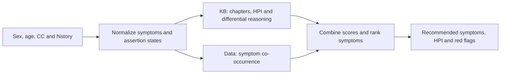

# Symptom Recommender

Recommend the next symptoms to ask about from a patient's sex, age in years, chief complaint (CC), and selected symptoms. The system combines historical symptom patterns with clinical knowledge and exposes a FastAPI service. Experimental results are in [REPORT.md](REPORT.md).

## 1. Solution overview

Historical co-occurrence provides evidence about which symptoms users select together. The clinical knowledge base (KB) organizes history questions, safety checks, and explanations. The hybrid combines these signals to rank unanswered symptoms.



The normalizer maps Thai/English names and aliases to symptom ids, preserves assertion states, and returns candidates for ambiguous text. CC selects the chapter; sex, age, and history inform clinical rules. Ranking uses:

`score = α × book_score + (1 − α) × data_score`

`book_score` sums the weights of differential diagnoses that explain each symptom; `data_score` uses training co-occurrence. Each component is divided by its maximum before mixing. The selected **α is 0.1**. Symptoms outside the KB retain data-based recommendations; red flags are handled separately from ranking.

The build pipeline is:

1. Parse CSV rows into profiles, confirmed/denied/unsure symptoms, and history of present illness (HPI) answers.
2. Split by chief complaint, keeping exact-copy groups together. Hold test cases and reference mappings fixed.
3. Learn aliases, symptom counts, and heuristic disease weights from training sessions only.
4. Select α using training leave-one-out, excluding exact copies together, then save artifacts for inference.

The KB contains 25 chapters, 549 symptom/history entries, and 529 disease/group entries. Sources include a Thai textbook on systematic clinical problem solving (2023), pediatric respiratory guidelines, and eye/ENT/urology notes, with page references in YAML. All chapters remain drafts; differential weights are not validated diagnostic probabilities.

## 2. Install and start

Use Python 3.11+ and run commands from `symptom-recommender/`:

```bash
python3 -m venv .venv
source .venv/bin/activate
python -m pip install -e ".[dev]"
make serve
```

Open [Swagger UI](http://127.0.0.1:8000/docs), [health](http://127.0.0.1:8000/health), or the [OpenAPI schema](http://127.0.0.1:8000/openapi.json).

Without artifacts, the API starts in `book_only` mode. For hybrid inference, place exactly one original CSV in `data/raw/`, run `make build`, then start the API. The build saves split, aliases, memory, and α under `build/`; inference loads artifacts without reading the CSV.

Hybrid mode requires all three files: `memory.json`, `aliases.json`, and `alpha.json`. Partial artifacts prevent startup. Override locations with `SYMPTOM_REC_KB_DIR` and `SYMPTOM_REC_BUILD_DIR`.

**The CSV, assignment, and user-derived artifacts are confidential.** Keep them local and out of Git and Docker images. All request examples below are invented.

## 3. Developer API and examples

Submit an initial complaint:

```bash
curl -s http://127.0.0.1:8000/v1/recommend \
  -H 'Content-Type: application/json' \
  -d '{"sex":"female","age":40,"chief_complaint":"cough"}'
```

Example response excerpt from `book_only` mode; additional fields are described in OpenAPI:

```json
{
  "model_mode": "book_only",
  "normalizer_profile": "rules",
  "needs_clarification": false,
  "urgent": false,
  "recommendations": [
    {"symptom": {"id": "fever", "en": "fever"}, "score": 0.6842105263157897},
    {"symptom": {"id": "myalgia", "en": "myalgia"}, "score": 0.3684210526315791}
  ]
}
```

Recommendations are ordered and include scores, book/data components, and reasons. All candidates are returned; clients choose how many to display. `symptom.label` is the display label, usually Thai; `symptom.en` provides an English name for KB entries. Scores and rankings depend on history and loaded artifacts.

For the next request, send the complete updated history, for example:

```json
{
  "sex": "female",
  "age": 40,
  "chief_complaint": "cough",
  "history": {
    "present": ["sore_throat"],
    "absent": ["fever"],
    "unsure": ["hemoptysis"],
    "historical": ["abdominal_pain"],
    "hpi": {"cough.duration": 1, "cough.character": "dry"}
  }
}
```

CC/history accept symptom ids or Thai/English text. `present` means current, `absent` means denied, `unsure` means uncertain, and `historical` means past/resolved. The last two are retained without treating them as current positive or negative evidence. Use `normalized_history` as the starting point for the next request; the server is stateless.

Read question ids, options, and units from `hpi_questions`: `cough.duration` uses weeks. Use `null`/`"unknown"` for unknown HPI, or supply free text through `"answers":{"cough":["1 week"]}`. Unparsed answers appear in `unread_answers`; explicit `history.hpi` overrides parsed values for the same question.

| Endpoint | Purpose |
|---|---|
| `POST /v1/recommend` | Rankings, HPI, red flags, urgency, differential weights, and normalization |
| `POST /v1/questions` | HPI lookup using the same request schema |
| `GET /v1/symptoms?q=cough&sex=female` | Search the catalog; supports `offset` and `limit` |
| `GET /health` | Loaded mode, α, model version, and normalizer profile |

Check `needs_clarification` and `normalization` for ambiguous/unmapped text and candidates. Read `urgent`, `urgent_reasons`, and `red_flags` for safety checks. Invalid types, conflicting history, or invalid HPI ids/options return HTTP 422 with a `detail` field. Use `/v1/recommend` for urgency; `/v1/questions` returns HPI only.

## 4. Run with Docker

Start the Docker daemon, then:

```bash
make docker-build
make docker-run
```

The API uses port 8000 and mounts `build/` read-only. To run without artifacts:

```bash
docker run --rm -p 127.0.0.1:8000:8000 symptom-recommender:local
```

Images run as a non-root user, include a health check, and exclude CSV/PDF files, model weights, and private artifacts. Inference works offline after dependencies and weights are prepared.

## 5. Test and reproduce the evaluation

```bash
make test       # Unit and API tests
make lint       # Static code checks
make validate   # KB and vignette structure
make evaluate   # Fixed train/test experiment; requires the CSV and build artifacts
```

Tests use synthetic fixtures and controlled embeddings; the optional real-data smoke test skips when the CSV is absent. To run API tests alone, use `python -m pytest -q tests/test_api.py`.

Evaluation reuses the saved split/targets and does not select a new seed or threshold from test results. It updates [REPORT.md](REPORT.md) and saves detailed measurements to `build/evaluation.json`.

Current hybrid hide-one HitRate@5 is **81/96 (84.38%)**, versus **77/96 (80.21%)** for co-occurrence; the difference interval includes zero. Unseen-text normalization agreement is **10/19**, a record-consistency proxy rather than physician-labelled accuracy.

## 6. Optional normalization experiments

`rules` is the default. `semantic` uses E5-small for candidates; `retrieval` uses an opt-in E5-base/ridge classifier. Both run locally on CPU with pinned model revisions. First install `python -m pip install -e ".[dev,semantic]"`.

| Step | E5-small | E5-base + ridge |
|---|---|---|
| Download public weights | `python scripts/prepare_semantic.py --download` | `python scripts/prepare_retrieval.py --download` |
| Prepare from training data | `HF_HUB_OFFLINE=1 python scripts/prepare_semantic.py`, then `HF_HUB_OFFLINE=1 python scripts/build.py --semantic` | `make normalization-review`, then `HF_HUB_OFFLINE=1 make retrieval-build` |
| Evaluate | `HF_HUB_OFFLINE=1 python scripts/evaluate.py --semantic` | `HF_HUB_OFFLINE=1 make retrieval-eval` |
| Start API | `HF_HUB_OFFLINE=1 make serve PROFILE=semantic` | `HF_HUB_OFFLINE=1 make serve PROFILE=retrieval` |

For retrieval Docker, use `make docker-build PROFILE=retrieval IMAGE=symptom-recommender:retrieval` and `make docker-run PROFILE=retrieval IMAGE=symptom-recommender:retrieval`. Weights stay outside the image; verify the profile at `/health`.

<a id="normalization-review"></a>

### Physician normalization review

Run `make normalization-review`, then `make review`, and open http://127.0.0.1:8001. Review the 197 development groups first; reserve 49 validation groups for evaluation after selecting the method. The page does not show model predictions.

Choose `map`/`clarify`/`out_of_kb`/`not_symptom`, enter labels such as `cough:present;fever:absent` and a reviewer name, then save. Use `unsure`/`historical` when supported by the text; do not infer additional symptoms from a suspected disease.

Files stay in `build/normalization_review/`. Direct TSV edits may change only decision/labels/reviewer/note; retain original text, counts, and rows. Run `make normalization-eval` for precision/recall/F1 and exact match, or `python scripts/normalization_review.py evaluate --subset validation` for validation. Unreviewed rows never become gold labels.

## 7. Codebase layout

| Path | Responsibility |
|---|---|
| `src/symptom_rec/data`, `normalize` | Session parsing, splits, and text normalization |
| `src/symptom_rec/engine`, `kb` | Knowledge/data ranking and KB validation |
| `src/symptom_rec/api`, `evaluation.py` | HTTP interface and evaluation |
| `kb/`, `scripts/`, `tests/` | YAML knowledge, experiment commands, and synthetic tests/vignettes |
| `data/raw/`, `build/` | Private data and generated artifacts (ignored) |

The system recommends questions, not confirmed diagnoses. Data limitations, evaluation independence, and experiment results are discussed in [REPORT.md](REPORT.md).
